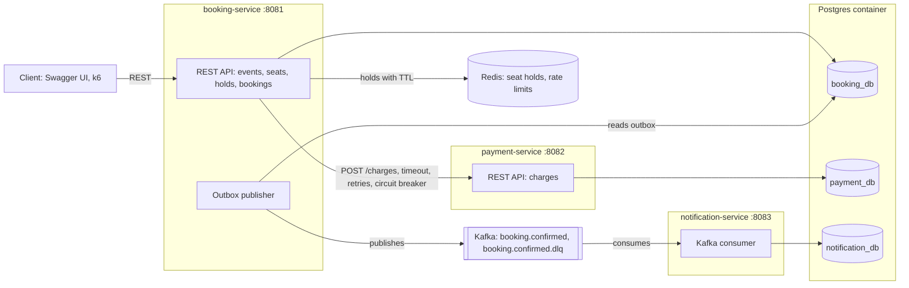
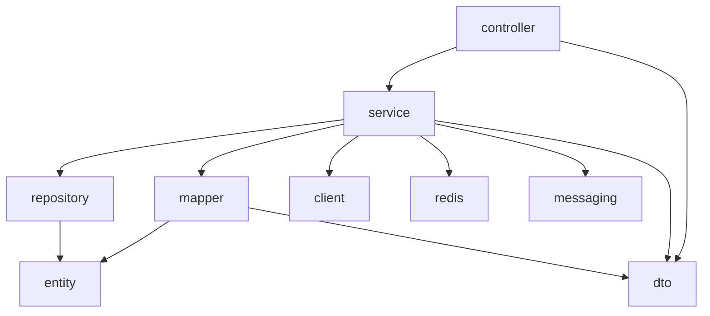
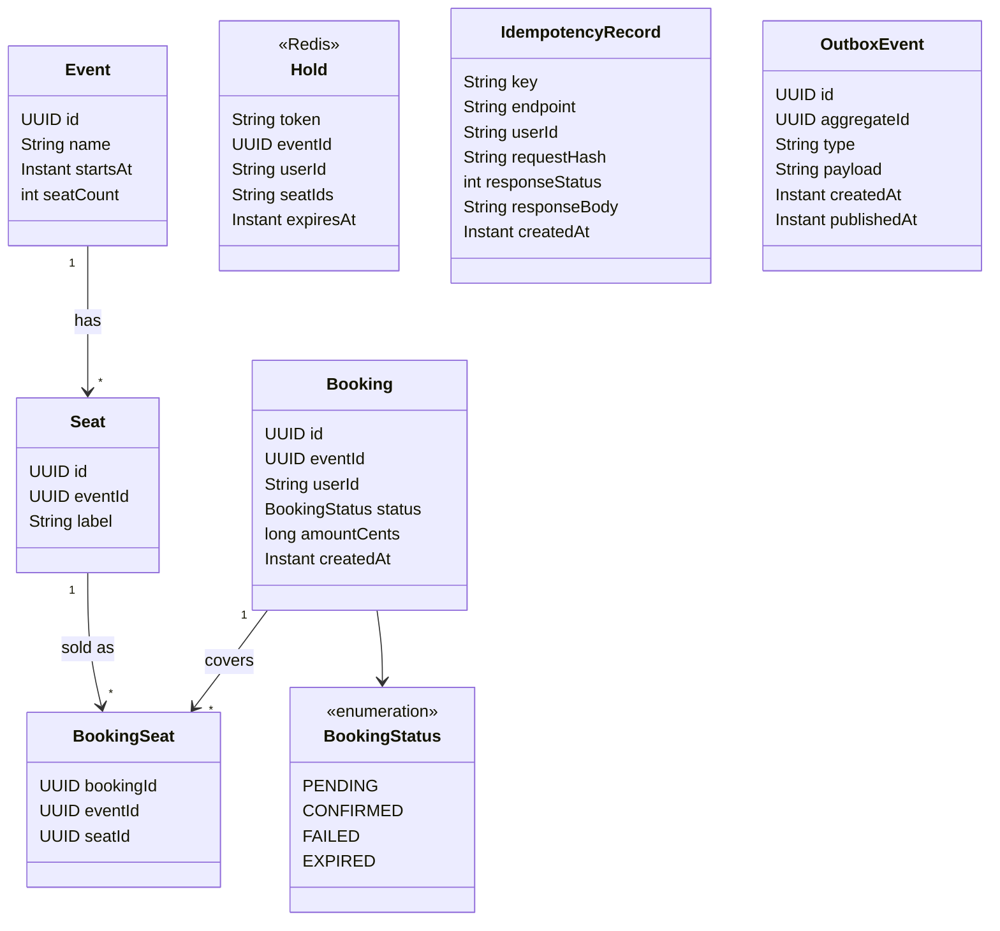
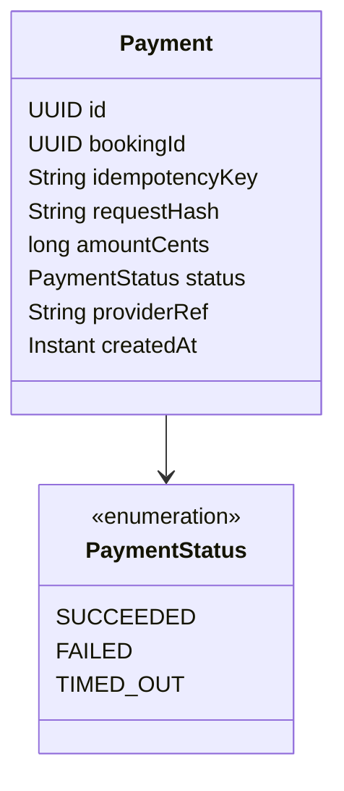
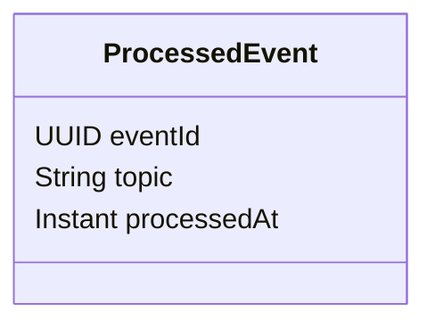

# OneSeat - Architecture

## Repository structure

One Git repository containing three independent Maven projects. There is no root pom.xml,
no parent pom and no shared library.

```text
oneseat-booking-platform/
|-- README.md
|-- docker-compose.yml         shared infrastructure only (Postgres, Redis, Kafka)
|-- infra/postgres/            init-databases.sql (booking_db, payment_db, notification_db)
|-- docs/                      requirements, architecture, adr/, api/, diagrams/
|-- k8s/                       infra/, booking-service/, payment-service/, notification-service/
|-- load-tests/                k6 scripts and results/
|-- .github/workflows/         one workflow per service
|-- booking-service/           standalone project, port 8081, com.oneseat.booking
|-- payment-service/           standalone project, port 8082, com.oneseat.payment
|-- notification-service/      standalone project, port 8083, com.oneseat.notification
```

## Independence rules

- Each service has its own pom.xml (Spring Boot starter parent), Maven wrapper, Dockerfile, CI workflow and README.
- Each service owns one database and its own Flyway migrations.
- Services never import each other's classes. They meet only through REST and Kafka.
- Configuration comes from environment variables, with defaults in application.yml.
- Every service call carries an X-Correlation-Id header.

Note: the service folders and docker-compose.yml are created from Day 8 onwards (booking-service Day 8, payment-service Day 16, notification-service Day 20).

## System diagram



Reading the diagram:
- Solid arrows inside a service box are that service's own work. Arrows between services are the only allowed communication: REST from booking to payment, and Kafka from booking to notification.
- Each service reaches only its own database. One Postgres container hosts all three.
- Redis is used only by booking-service.

## Service boundaries

| | booking-service | payment-service | notification-service |
|---|---|---|---|
| Port | 8081 | 8082 | 8083 |
| Database | booking_db | payment_db | notification_db |
| Owns | Events, seats, holds (Redis), bookings, idempotency records, outbox | Payments and charge idempotency | Processed events |
| REST API | Events, seats, holds, bookings | POST /charges, GET /charges/{bookingId} | Health only |
| Calls | payment-service (REST), Redis, Kafka | Nothing | Kafka |
| Publishes | booking.confirmed | Nothing | Nothing |
| Consumes | Nothing | Nothing | booking.confirmed |
| Must never | Read payment_db | Read booking_db | Read booking_db or payment_db |

GET /charges/{bookingId} exists so booking-service can reconcile a stale PENDING booking (FS-15).

## Project and package layout

Each service is a standalone Maven project with its own pom.xml and Maven wrapper.

### Layer responsibilities

| Layer | Responsibility |
|---|---|
| controller | Handles HTTP requests and responses only |
| service | Contains business logic and transaction boundaries |
| dto | Contains request and response DTOs |
| entity | Contains persistence entities |
| repository | Contains database queries and persistence operations |
| mapper | Converts between entities and DTOs |
| exception | Contains service-specific exceptions and error handling |
| config | Contains service configuration |
| common | Contains shared utilities within the service |
| redis | Contains Redis-related code where needed |
| client | Contains REST clients for external services where needed |
| messaging | Contains Kafka messaging code where needed |
| provider | Contains payment provider integration where needed |
| mail | Contains email functionality where needed |

### Dependency direction



Dependencies must remain within the service. Entities must not depend on other layers. Services return DTOs, never entities.

### booking-service

```text
booking-service/
  src/
    main/
      java/com/oneseat/booking/
        controller/
        service/
        dto/
        entity/
        repository/
        mapper/
        exception/
        config/
        common/
        redis/
        client/
        messaging/
      resources/
        application.yml
        db/migration/
    test/
      java/com/oneseat/booking/
        controller/
        service/
        repository/
```

### payment-service

```text
payment-service/
  src/
    main/
      java/com/oneseat/payment/
        controller/
        service/
        dto/
        entity/
        repository/
        mapper/
        exception/
        config/
        common/
        provider/
      resources/
        application.yml
        db/migration/
    test/
      java/com/oneseat/payment/
        controller/
        service/
        repository/
```

### notification-service

```text
notification-service/
  src/
    main/
      java/com/oneseat/notification/
        controller/
        service/
        dto/
        entity/
        repository/
        mapper/
        exception/
        config/
        common/
        messaging/
        mail/
      resources/
        application.yml
        db/migration/
    test/
      java/com/oneseat/notification/
        controller/
        service/
        repository/
```

### Draft API endpoints

| Service | Endpoint | Purpose |
|---|---|---|
| booking-service | Events, seats, holds and bookings REST endpoints | Event and booking operations |
| payment-service | POST /charges | Create or retrieve an idempotent charge |
| payment-service | GET /charges/{bookingId} | Retrieve payment status for booking reconciliation |
| notification-service | Health endpoint | Service health |

### Naming conventions

| Component | Naming |
|---|---|
| Controller | XxxController |
| Service | XxxService |
| Repository | XxxRepository |
| Request DTO | XxxRequest |
| Response DTO | XxxResponse |
| Mapper | XxxMapper |
| Exception | XxxException |

### Test layout

Test packages mirror the corresponding main packages.

- Controllers: WebMvcTest.
- Services: Mockito unit tests.
- Repositories: Testcontainers.
- Integration tests: Testcontainers where infrastructure integration is required.

Each service also has src/main/resources/application.yml and db/migration/ for its own Flyway files.

## Domain model by owning service

### booking-service



### payment-service



`Payment.idempotencyKey` uses the booking ID as its idempotency key. A repeated request for the same booking ID must return the stored payment instead of charging again.

### notification-service



### Draft decisions (confirm on Day 5)

- Seat has no stored status. SOLD means the seat is in a CONFIRMED booking, HELD means a hold exists in Redis or the seat is in a PENDING booking, and anything else is AVAILABLE.
- The unique constraint on (event_id, seat_id) lives on BookingSeat. Day 5 decides how FAILED and EXPIRED bookings free their seats.
- Hold exists only in Redis, as a key with a 5 minute TTL, never in Postgres.
- Payment is idempotent by booking id: the same booking id returns the stored payment instead of charging again.
- ProcessedEvent makes consumers idempotent. A repeat of the same event id is ignored.
- IDs are UUIDs generated by the application.